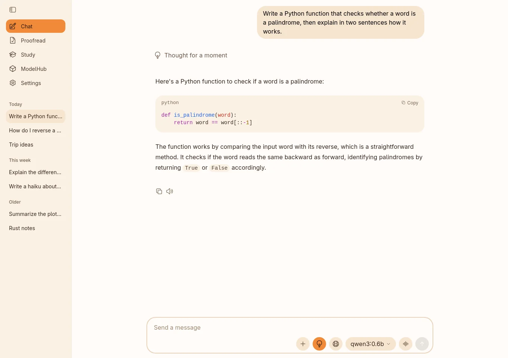
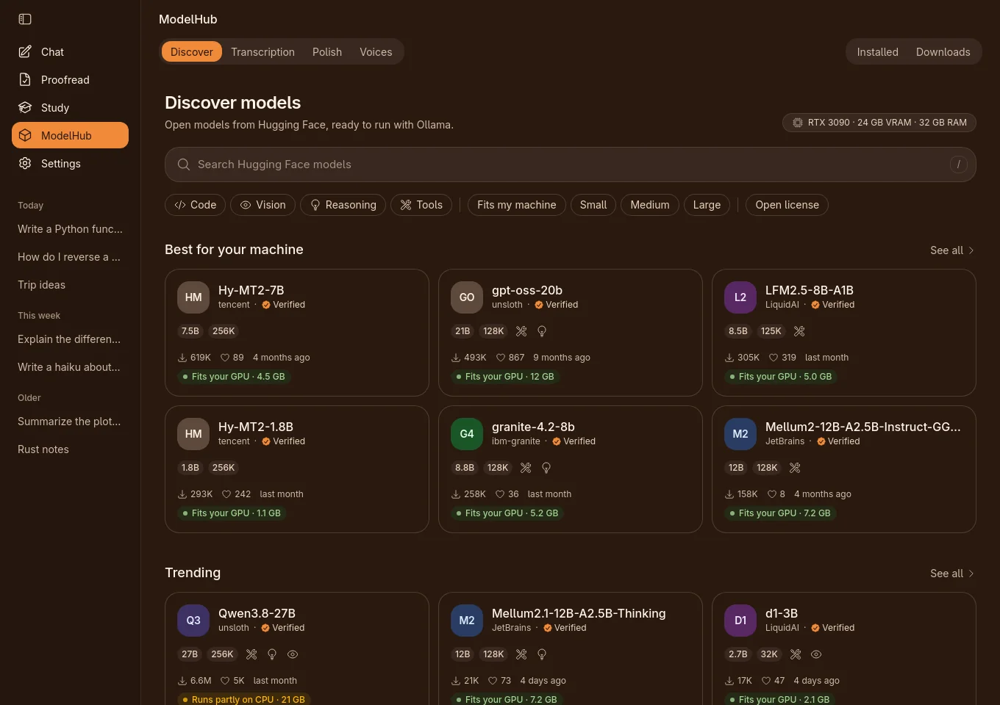
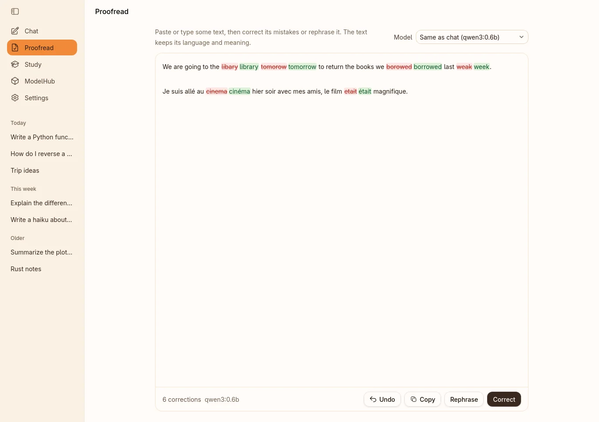
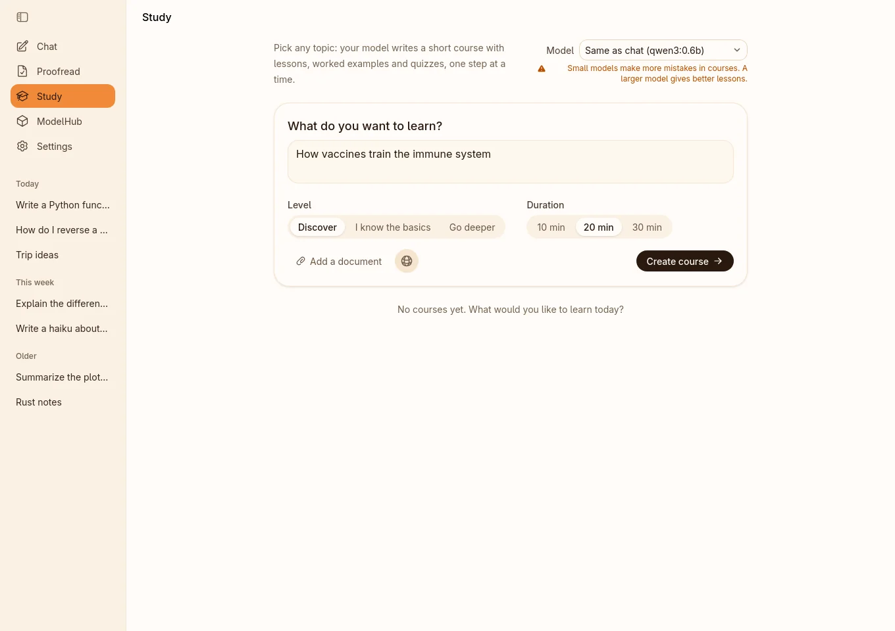
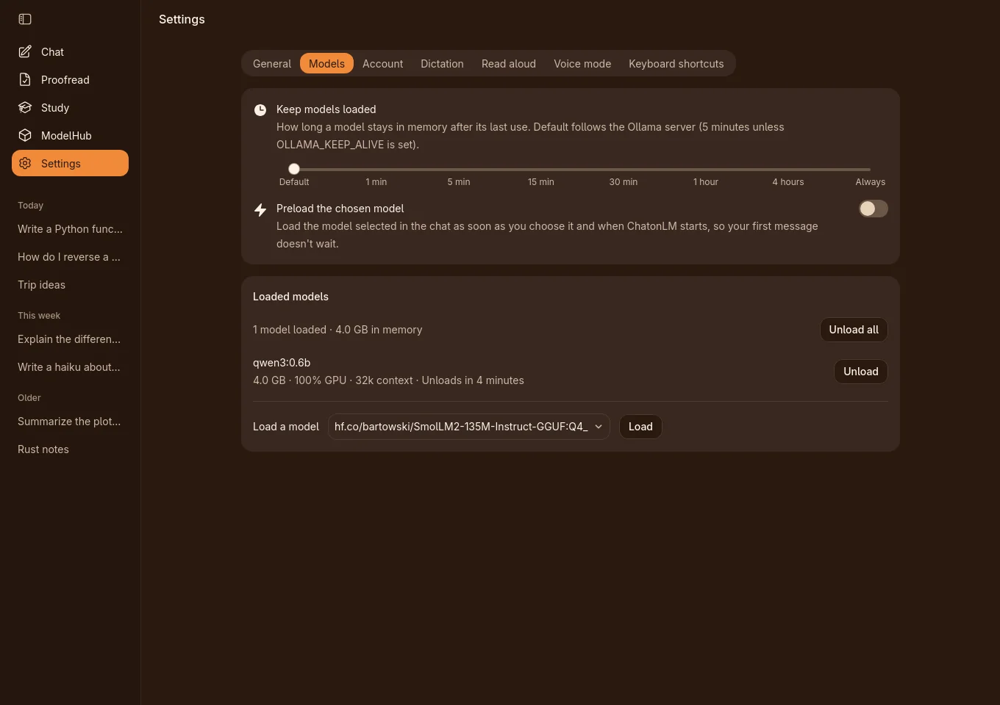

# ChatonLM

**The tools of local AI in one desktop app, for Windows and Linux.**

ChatonLM is a free, open-source app for using large language models on your
own computer. One window brings together chat, a model browser for Hugging
Face, dictation, read aloud and voice conversations, proofreading and
step-by-step courses. It is built on [Ollama](https://ollama.com) and
includes it, so it works out of the box: no account, no subscription, no
telemetry.

ChatonLM is an independent project. Its layout and behavior follow the
official Ollama app for Windows and macOS; its look is its own.

Website: [chatonlm.com](https://chatonlm.com), in English, French and Spanish.



> [!NOTE]
> ChatonLM 0.9 is a beta. Please report problems in
> [Issues](https://github.com/Elwynn18/chatonlm/issues).

## Features

- **Chat**, as in the official app: streaming answers with Markdown, code
  highlighting and math, editable messages, and a history with favorites.
  Reasoning models get a **Think** button, with a thinking level when the
  model supports it.
- **Attachments**: images (for vision models), PDFs, text and code files, added
  with the + button, by drag and drop, or by pasting.
- **ModelHub**: browse open models from Hugging Face, see which ones fit your
  graphics card and memory, then download them into Ollama in one click.
  Installed models and downloads have their own tabs. When a newer version of
  an installed model is published, ChatonLM says so and updates it in one
  click.
- **Ollama account and web search**: sign in to your ollama.com account
  through your Ollama server, then let models search the web, as in the
  official app.
- **Dictation**: press a global shortcut and speak in any app. Speech is
  transcribed on your computer by Parakeet (25 European languages) or Whisper
  (99 languages), optionally cleaned up by an Ollama model, and copied to the
  clipboard.
- **Read aloud and voice mode**: answers can be read aloud by a natural voice
  (English, French or Spanish), and in [voice mode](#voice-mode) you talk
  with the model hands-free: ChatonLM transcribes what you say, sends it, reads
  the answer aloud and listens again. Everything runs on your computer.
- **Proofread**: correct or rephrase a text in the app, or the text selected
  in any app with a global shortcut, which puts the corrected text in its
  place.
- **Study**: pick a topic, and your model writes a short course with lessons,
  worked examples and quizzes, from your own documents and the web if you
  want.
- **Models settings**: keep models loaded for as long as you want, preload the
  chosen model, see loaded models and unload them.
- **Easy Link**: talk to your models from your phone, through your own
  Telegram or Discord bot (see [Easy Link](#easy-link)).
- **Built-in Ollama**: no setup needed. ChatonLM uses the Ollama of your
  computer when there is one, and its own copy otherwise (see
  [Ollama](#ollama)).
- **Updates** from Settings, signed and checked before they are installed.
- **English, Spanish and French** interface: you choose the language on first
  launch (the one of your system is proposed) and can change it in Settings.
- **A guided tour on first launch**: four steps that open the main pages and
  point at what each one is for. You can skip it at any time.
- Light and dark themes, a tray icon, and keyboard shortcuts (listed in
  Settings › Keyboard shortcuts).
- **The same tools on Windows and Linux.**

| ModelHub                                                                   | Proofread                                                                                  |
| -------------------------------------------------------------------------- | ------------------------------------------------------------------------------------------ |
|  |          |
| **Study**                                                                  | **Models settings**                                                                        |
|               |  |

## Voice mode

Click the wave button next to Send, or press Ctrl+Shift+Space, to talk with
the model of the conversation. ChatonLM listens, sends your sentence when you
stop speaking, reads the answer aloud, then listens again. The conversation is
written and saved as usual.

- **100% local**: speech detection, transcription, echo cancellation and the
  voice run on your computer. Only the transcribed text is sent, to your
  Ollama server, like a typed message.
- **Interrupt by speaking**: echo cancellation removes ChatonLM's own voice
  from what the microphone hears, so you can cut an answer just by talking,
  even on speakers (headphones work best). Space or a click on the bar also
  interrupts; Esc ends voice mode.
- **Settings › Voice mode**: hands-free or push-to-talk, the pause that ends
  your turn, interruption by speaking, and the instructions given to the
  model (short spoken answers, no reasoning unless you allow it).
- **Requirements**: a microphone, the speech recognition model of Dictation
  (Parakeet or Whisper) and the voice of your language (English, French or
  Spanish). When one is missing, ChatonLM offers to download it, with its
  size, then starts.

## Easy Link

Easy Link connects a Telegram or Discord bot that you create to the models of
your computer: you write to the bot from your phone, and your model answers.
The conversations are saved in ChatonLM like the others, marked with a small
icon.

- **Set up in Settings › Easy Link**: create a bot (with @BotFather on
  Telegram, or in the Discord developer portal), paste its token, then link
  your account with the 6-digit pairing code that ChatonLM shows. Only linked
  accounts are answered; you can link several and unlink them at any time.
- **Commands**: `/new`, `/stop`, `/models`, `/model`, `/load`, `/unload`,
  `/status`, `/web on` and `/web off`, `/help` (on Discord, `!models` also
  works). Models cannot be downloaded or deleted from the bot, and settings
  cannot be changed.
- **Photos and voice messages**: a photo goes to a model that can see; a voice
  message is transcribed on your computer by the speech recognition model of
  Dictation, then sent as text.
- **Web search**, with `/web on`, if your Ollama account is connected.
- **ChatonLM must be running** on your computer (it keeps running in the tray
  when you close the window). Nothing is hosted elsewhere, and no port is
  opened on your computer.
- **On Discord**, the bot answers private messages only, and Discord lets you
  write to a bot only if you share a server with it: ChatonLM gives you the
  link that invites your bot to one of your servers.

Your messages and the answers travel through the servers of Telegram or
Discord (see [Privacy](#privacy)).

## Install

ChatonLM runs on 64-bit PCs (x86-64), on Windows 11 and on Linux. Download
the files from the
[latest release](https://github.com/Elwynn18/chatonlm/releases/latest) or
from [chatonlm.com](https://chatonlm.com).

### Windows

For Windows 11, 64-bit. Run `chatonlm_<version>_x64-setup.exe`: ChatonLM
installs for your user account, without administrator rights.

- The installer doesn't have a certificate that Windows recognizes yet, so
  Windows shows a "Windows protected your PC" screen: click **More info**,
  then **Run anyway**. Updates are signed by ChatonLM and checked before they
  are installed (see [Updates](#updates)).
- ChatonLM uses Microsoft Edge WebView2, which is part of Windows 11. If it
  is missing, the installer downloads it.

### Linux

ChatonLM needs glibc 2.35 or later: Ubuntu 22.04, Debian 12, Fedora 36 and
later, and most current distributions. The release packages are tested on
Ubuntu 22.04 and 24.04 and on Fedora 44, and ChatonLM is developed on Arch
Linux.

#### AppImage (recommended)

The AppImage runs on any distribution, without installation:

```bash
chmod +x chatonlm_*_amd64.AppImage
./chatonlm_*_amd64.AppImage
```

- Keep it in a folder of your own, for example `~/Applications`: ChatonLM
  updates itself by replacing the file, so the folder must be writable.
- On its first start, ChatonLM adds itself to your applications menu. If you
  move the AppImage, it updates the menu entry the next time you start it. You
  can remove the entry in Settings › General › Applications menu.
- The AppImage needs FUSE, which most desktop distributions include. If it
  doesn't start for that reason, install your distribution's `fuse3` package,
  or start it without FUSE:

  ```bash
  APPIMAGE_EXTRACT_AND_RUN=1 ./chatonlm_*_amd64.AppImage
  ```

#### Debian and Ubuntu (.deb)

For Ubuntu 22.04 or later, Debian 12 or later, and their derivatives:

```bash
sudo apt install ./chatonlm_*_amd64.deb
```

### Requirements

- **Graphics card (optional).** The built-in Ollama runs models on the
  processor, or on the graphics card through Vulkan when a Vulkan driver is
  installed: your card's driver on Windows; on Linux, your card's driver and
  the Vulkan loader (`libvulkan1` on Debian and Ubuntu). To use CUDA (NVIDIA)
  or ROCm (AMD), [install Ollama](https://ollama.com/download) on your
  computer: ChatonLM then uses it.
- **Dictation with Whisper** needs a processor with AVX2 (x86-64-v3). Without
  it, ChatonLM offers only Parakeet, which works on any x86-64 processor.
- **Global shortcuts** (dictation, proofreading). On Windows, you choose the
  keys in Settings › Keyboard shortcuts (Ctrl+Alt+D and Ctrl+Alt+C by
  default). On Linux, they use the desktop's GlobalShortcuts portal: KDE
  Plasma 6 or GNOME 48 and later; on other desktops, bind
  `chatonlm --dictate` and `chatonlm --proofread` to keys in your desktop's
  own shortcut settings.
- **Replacing the selected text** after a correction. On Linux, ChatonLM
  sends the paste keystroke through the desktop's RemoteDesktop portal (KDE
  Plasma, GNOME), which asks for your permission the first time; on other
  desktops the corrected text is copied, and you paste it with Ctrl+V. On
  Windows, it can't reach an app started as administrator. Turn it off in
  Settings › Keyboard shortcuts to only copy the corrected text.
- **Tray icon**: the notification area on Windows; on Linux, built into KDE
  Plasma and most desktops, while GNOME needs the AppIndicator extension.
  Without a tray, closing the window quits ChatonLM.

## Ollama

ChatonLM talks to an Ollama server, and finds one on its own:

- **Ollama is installed and running on your computer**: ChatonLM uses it, with
  your models and your GPU setup.
- **Ollama is installed, but isn't running**: ChatonLM offers **Start
  Ollama** (on Windows, it opens the Ollama app; on Linux, your system asks
  for your password to start the service), or **Use the built-in Ollama
  instead**. It never starts the built-in one silently in this case.
- **Ollama isn't installed**: ChatonLM starts the copy it includes (Ollama
  0.40.3, processor and Vulkan). It listens only on 127.0.0.1, on a private
  port, so only apps on your computer can reach it, and it stops when you
  quit ChatonLM.
- **You entered a server address** (Settings › General › Server address, or
  the `OLLAMA_HOST` environment variable), for example another computer on
  your network: ChatonLM uses that server. If it doesn't answer, ChatonLM says
  so and offers **Use the built-in Ollama**; it never switches on its own.

You can change this at any time in Settings › General › Ollama.

**Model folders.** Each Ollama keeps its own models:

- The built-in Ollama stores them in the `ollama/models` folder of
  [ChatonLM's data](#your-data). Choose another folder in Settings › General ›
  Model location (no password needed).
- For the Ollama service of a Linux system, Model location moves its models
  to the folder you choose: ChatonLM asks for your password, adds a systemd
  setting to the service, moves the models and restarts the service. On
  Windows, and when Ollama runs some other way on Linux (a user service, or
  started by hand), ChatonLM shows what to do instead.

## Updates

ChatonLM checks for a new version when it starts, then every hour, from this
repository's GitHub releases. With **Auto-download updates** on (the
default), it downloads the update in the background; it is installed when you
click **Restart to update**, never on its own.

- Every update is signed. ChatonLM checks the signature, the version and the
  package type before installing, and refuses anything else.
- **Windows**: ChatonLM runs the new installer itself; no administrator
  rights are needed.
- **AppImage**: the new file replaces the old one in the same folder; no
  password is needed.
- **.deb**: your system asks for your password to install the package.
- A copy that ChatonLM doesn't manage (installed by a distribution's package
  manager, Flatpak or Snap, or built from source) never checks for updates;
  the Updates card explains why. Updates then come through your package
  manager.

## Privacy

ChatonLM has no account of its own, no telemetry and no analytics. Your chats,
attachments and settings stay on your computer, and dictation and voice mode
are transcribed locally.

ChatonLM itself connects only to:

- **Hugging Face** (huggingface.co and its status page), when you open
  ModelHub (model lists, model cards, file sizes; the first-launch tour opens
  it at its second step) and when you download a speech recognition model or
  a voice;
- **ollama.com**, to check that a model name typed in the model picker exists,
  and to show your account picture once you are signed in;
- **ollama.com or Hugging Face**, whichever the model came from, to check
  whether a newer version of an installed model is available: for the model
  selected in a chat, and for all of them when you open the Installed tab of
  ModelHub. Only the name of the model is sent;
- **GitHub** (github.com), to check for and download updates, and to download
  the model files of a voice;
- **Telegram** (api.telegram.org) **or Discord** (discord.com and its file
  servers), only if you connect a bot in Settings › Easy Link, and only while
  it is turned on: the messages, photos and voice messages you send to your
  bot, and the answers of your model, go through that service. The token of
  your bot is stored in the database of ChatonLM, on your computer.

Everything else goes through your Ollama server: chats, model downloads,
your Ollama account and web search (handled by Ollama and ollama.com). If
your server is on another computer, your messages, attachments and the
transcripts cleaned up by dictation are sent to it. Links open in your web
browser.

## Your data

Everything ChatonLM stores is in one folder (apart from the menu entry of the
AppImage):

- Windows: `%LOCALAPPDATA%\com.chatonlm.chatonlm`
- Linux: `~/.local/share/com.chatonlm.chatonlm`

It holds the database (chats, attachments, settings), the models and log of
the built-in Ollama, the speech recognition models, the voices, the ModelHub
cache, logs and downloaded updates.

To keep it elsewhere, set the `CHATONLM_DATA_DIR` environment variable to an
absolute path before starting ChatonLM. On Linux, for example:

```bash
CHATONLM_DATA_DIR=/path/to/folder ./chatonlm_*_amd64.AppImage
```

### Uninstall

1. Remove the app.
   - **Windows**: Settings › Apps › Installed apps › ChatonLM › Uninstall.
     Your data is kept unless you tick the box that deletes it.
   - **AppImage**: first turn off Settings › General › Applications menu ›
     **Show in the applications menu** (this removes the menu entry and its
     icon), then delete the AppImage. If the AppImage is already gone, delete
     `~/.local/share/applications/com.chatonlm.chatonlm.desktop`.
   - **.deb**: `sudo apt remove chatonlm`.
2. Delete the [data folder](#your-data) to remove your chats, settings and
   the built-in Ollama's models.
3. On Linux, if you used Model location, or **Fix** for the Ollama service of
   your system, ChatonLM added files named `zz-chatonlm-*.conf` to
   `/etc/systemd/system/ollama.service.d/`. They keep working without
   ChatonLM. To undo them, move your models back to Ollama's default folder,
   delete the files, then run
   `sudo systemctl daemon-reload && sudo systemctl restart ollama`.

## Build from source

These steps are for Linux. You need Rust (the version in
`rust-toolchain.toml`, installed by rustup), Node.js 24 (`.nvmrc`), and the
development files of WebKitGTK 4.1, GTK 3, libsoup 3, ALSA and D-Bus, with
CMake and Clang. On Ubuntu 22.04 or later:

```bash
sudo apt install build-essential pkg-config cmake clang libclang-dev \
  libwebkit2gtk-4.1-dev libgtk-3-dev libsoup-3.0-dev \
  libjavascriptcoregtk-4.1-dev libasound2-dev libdbus-1-dev
```

Then:

```bash
git clone https://github.com/Elwynn18/chatonlm.git
cd chatonlm
npm ci
npm run tauri build -- --no-bundle
```

The program is `src-tauri/target/release/chatonlm`. A copy built this way:

- has no built-in Ollama: use the Ollama of your computer;
- needs ONNX Runtime 1.28 for Parakeet dictation: set `ORT_DYLIB_PATH` to its
  `libonnxruntime.so.1`, for example from Microsoft's
  `onnxruntime-linux-x64-1.28.3.tgz`. Without it, Whisper still works;
- doesn't update itself.

For development, `npm run tauri dev -- --config src-tauri/tauri.dev.conf.json`
starts ChatonLM with hot reload, under its own identifier, so it doesn't share
data with an installed copy.

The release packages are built by GitHub Actions, which also fetches the
pinned ONNX Runtime and Ollama and writes the license notices: on Ubuntu
22.04 for Linux ([`packages.yml`](.github/workflows/packages.yml)), and with
the MSVC toolchain for Windows
([`packages-windows.yml`](.github/workflows/packages-windows.yml), the
reference for building on Windows).

### Contributing

Issues and pull requests are welcome. Before opening a pull request, please
run `npm run lint`, `npm run typecheck`, `npm test` and
`cargo test --manifest-path src-tauri/Cargo.toml`. Comments in the code and
commit messages are in French; the interface is in English, Spanish and
French, and every text change goes into all three languages
(`src/locales/`). A fix or an improvement applies to both Windows and Linux.

## License and credits

ChatonLM is released under the [MIT License](LICENSE), Copyright (c) 2026
Elwynn18 and ChatonLM contributors.

[THIRD_PARTY_LICENSES](THIRD_PARTY_LICENSES) lists the third-party material it
includes, with their notices. The packages also carry the licenses of every
Rust crate and npm package built into ChatonLM, of ONNX Runtime and of the
built-in Ollama: in `/usr/share/doc/chatonlm` on Linux, and in the `licenses`
folder of the installation on Windows.

- The interface follows, and partly adapts, the official
  [Ollama](https://github.com/ollama/ollama) app (MIT License, Copyright (c)
  Ollama); the adapted files are listed in THIRD_PARTY_LICENSES, part 1.
- The packages include [Ollama](https://github.com/ollama/ollama) 0.40.3 (MIT)
  and [ONNX Runtime](https://github.com/microsoft/onnxruntime) 1.28.3 (MIT),
  unmodified. The built-in Ollama also contains the GNU OpenMP library
  (libgomp), under the GPL 3 with the GCC Runtime Library Exception.
- The Windows package also contains the Microsoft Visual C++ runtime
  libraries, under Microsoft's redistribution terms (THIRD_PARTY_LICENSES,
  part 9).
- The AppImage also contains system libraries from Ubuntu 22.04, some under
  the GNU LGPL. Their source code, and that of the AppImage runtime, is
  published with each release as `chatonlm_<version>_amd64.AppImage-sources.tar`.
- Speech recognition models are downloaded on demand, not shipped:
  [Parakeet TDT 0.6B v3](https://huggingface.co/nvidia/parakeet-tdt-0.6b-v3)
  by NVIDIA (CC BY 4.0, in the ONNX conversion by
  [istupakov](https://huggingface.co/istupakov/parakeet-tdt-0.6b-v3-onnx)),
  and [Whisper](https://github.com/openai/whisper) by OpenAI (MIT, in the
  [whisper.cpp](https://github.com/ggml-org/whisper.cpp) format).
- Voices for Read aloud are downloaded on demand, not shipped:
  [Pocket TTS](https://github.com/kyutai-labs/pocket-tts) by Kyutai (model
  CC BY 4.0, exported to ONNX and quantized by ChatonLM; code MIT), with the
  voices estelle (CC0), alba (Alba MacKenna, CC BY 4.0) and lola (Mozilla
  Common Voice, CC0).
- Voice mode detects speech with the
  [Silero VAD](https://github.com/snakers4/silero-vad) model by the Silero
  Team (MIT), built into ChatonLM, and cancels echo with
  [sonora](https://github.com/dignifiedquire/sonora), a Rust port of the
  WebRTC audio processing (BSD-3-Clause).
- Built with [Tauri](https://tauri.app), [React](https://react.dev),
  [Streamdown](https://github.com/vercel/streamdown),
  [Shiki](https://shiki.style) and [KaTeX](https://katex.org).

ChatonLM is not affiliated with, endorsed or sponsored by Ollama. "Ollama" is a
trademark of its owner and is used only to describe compatibility.
