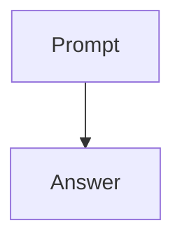

# Markdown check

Plain paragraph with **bold**, *italic*, ***bold italic***, ~~strike~~ and `inline code`.

## Lists

- First item
- Second item with **bold**
  - Nested item
  - Another nested item
    - Third level
- Third item

1. One
2. Two
   1. Two point one
   2. Two point two
3. Three

- [x] Done task
- [ ] Open task

### Table

| Model | Size | Context |
|:------|-----:|:-------:|
| qwen3:0.6b | 523 MB | 40K |
| qwen3.5:0.8b | 1.0 GB | 256K |

#### Quote

> A quote with **bold** text and `code`.
>
> > A nested quote.

##### Code

Run `ollama serve` first.

```typescript
interface Model {
  name: string;
  size: number;
}

export function largest(models: Model[]): Model | undefined {
  return models.reduce<Model | undefined>(
    (best, model) => (best && best.size >= model.size ? best : model),
    undefined,
  );
}
```

```python
def greet(name: str) -> str:
    """Return a friendly greeting."""
    return f"Hello, {name}!"
```

```bash
ollama pull qwen3:0.6b && ollama run qwen3:0.6b "Hi"
```

```
no   language
    indented line
```

```ruby
puts "unknown language"
```

```Python
print("upper-case language tag")
```



```javascript
const greet = (name) => `Hello, ${name}!`;
console.log(greet("Ollama"), /\d+/.test("42"));
```

```shell
for file in *.md; do
  echo "Checking $file" && wc -l "$file"
done
```

```json
{
  "model": "qwen3:0.6b",
  "stream": true,
  "options": { "temperature": 0.7, "stop": ["\n"] }
}
```

```html
<!doctype html>
<html lang="en">
  <head>
    <style>
      .sm\:hover\:bg-blue-500\/50:hover { color: #3b82f6; }
    </style>
  </head>
  <body>
    <p id="greeting">Hello</p>
    <script>document.title = "Hi " + 2;</script>
  </body>
</html>
```

```css
.card > .title::before {
  content: "\2014";
  color: rgb(59 130 246 / 50%);
}
.sm\:hover\:bg-blue-500\/50, .é { margin: 0 auto !important; }
```

```tsx
type Props = { name: string; count?: number };

export function Badge({ name, count = 0 }: Props) {
  return <span title={name}>{`${name}: ${count}`}</span>;
}
```

```jsx
export default function List({ items }) {
  return (
    <ul>
      {items.map((item) => <li key={item.id}>{item.label}</li>)}
    </ul>
  );
}
```

```go
type Job struct {
	ID    int
	Done  chan<- bool
	Steps []string `json:"steps"`
}

func run(jobs <-chan Job) {
	for job := range jobs {
		job.Done <- len(job.Steps) > 0
	}
}
```

```rust
use std::collections::HashMap;

fn main() {
    let mut counts: HashMap<&str, usize> = HashMap::new();
    *counts.entry("ollama").or_insert(0) += 1;
    println!("{counts:?}");
}
```

```java
public class Hello {
    public static void main(String[] args) {
        System.out.println("Hello, " + args.length);
    }
}
```

```c
#include <stdio.h>

int main(void) {
    printf("%d\n", 42);
    return 0;
}
```

```cpp
#include <vector>
#define SQUARE(x) ((x) * (x))

template <typename T>
T sum(const std::vector<T>& values, int **grid = nullptr) {
    T total{};
    for (const auto& v : values) total += SQUARE(v);
    return total;
}
```

```sql
SELECT name, size
FROM models
WHERE size > 1000000 AND name LIKE 'qwen%'
ORDER BY size DESC;
```

```swift
struct Model {
    let name: String
    var size: Int = 0
}

let models = [Model(name: "qwen3")]
print(models.map { $0.name })
```

```yaml
server:
  host: 127.0.0.1
  port: 11434
models:
  - name: qwen3:0.6b # default
    keep_alive: 5m
```

```markdown
# Release notes

- **Faster** startup
- See [the docs](https://example.com/docs) and `ollama run`
```

###### Math

Inline \(a^2 + b^2 = c^2\) and inline double dollars $$x^2 + 1$$, then display:

\[
E = mc^2
\]

$$
\sum_{i=1}^{n} i = \frac{n(n+1)}{2}
$$

Single dollars stay text: $5 and $10.

## Links

[Ollama docs](https://example.com/ollama-docs), [local server](http://localhost:11434), [x](javascript:window.__pwned=1), [empty link]() and <https://example.com/autolink>.

[Titled link](https://example.com/titled "Docs title") and [https://example.com/shown](https://example.com/real).

## Raw HTML

<script>window.__pwned=1</script>

<iframe src="https://example.com/embed"></iframe>


The end.
